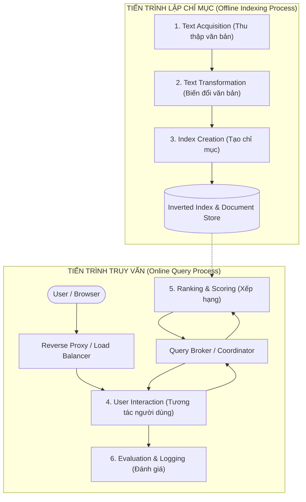

Dưới đây là bản **tổng hợp chuyên sâu và toàn diện toàn bộ kiến thức cốt lõi Chapter 2: Architecture of a Search Engine (SEG301)**, chuẩn hóa hệ thống logic học thuật, giữ nguyên toàn bộ **Keywords** thuật ngữ chuyên ngành tiếng Anh phục vụ tối ưu cho việc ôn thi trắc nghiệm, bài tập tính toán và vấn đáp.

---

# CHAPTER 2: ARCHITECTURE OF A SEARCH ENGINE

## 1. TỔNG QUAN, MỤC TIÊU CỐT LÕI & SO SÁNH IR VS DBMS

* **Information Need vs. Query**:
  * **Information Need (Nhu cầu thông tin)**: Khái niệm trừu tượng trong nhận thức của người dùng về thông tin cần tìm kiếm.
  * **Query (Truy vấn)**: Chuỗi từ khóa cụ thể do người dùng tạo ra và gửi tới hệ thống IR nhằm diễn đạt nhu cầu thông tin đó.
* **Inverted Index (Chỉ mục đảo)**: Cấu trúc dữ liệu cốt lõi ánh xạ từ các từ khóa (**Terms**) tới danh sách vị trí và tài liệu xuất hiện của chúng (**Locations/Documents**).
* **2 Mục tiêu thiết kế tối thượng của Search Engine**:
  1. **Effectiveness (Chất lượng / Độ hiệu quả)**: Trả về tập tài liệu có độ liên quan cao nhất (*most relevant*). Đo lường qua các chỉ số chất lượng như Precision, Recall, MAP, NDCG.
  2. **Efficiency (Tốc độ / Hiệu năng)**: Xử lý câu truy vấn nhanh nhất có thể (*Response Time, Latency SLA < 50ms - 100ms*) với thông lượng phục vụ cao nhất (*Throughput hàng nghìn QPS*).
* **Định luật Little (Little's Law) trong Đánh giá Hiệu năng Search Engine**:
  * Mối quan hệ giữa Thông lượng (**Throughput** $\lambda$), Độ trễ trung bình (**Average Latency** $W$) và Số lượng truy vấn đồng thời trong hệ thống (**Concurrent Queries** $L$):
    $$L = \lambda \times W$$
  * *Ví dụ tính toán thực tế:* Một cụm máy chủ tìm kiếm nhận thông lượng $\lambda = 10,000 \text{ QPS}$ (Queries Per Second) với độ trễ phản hồi trung bình $W = 50\text{ ms} = 0.05\text{ s}$. Số lượng câu truy vấn đang được xử lý đồng thời trong cluster là:
    $$L = 10,000 \times 0.05 = 500 \text{ concurrent queries}$$
* **Bảng so sánh chuyên sâu: Search Engine (IR System) vs. Hệ quản trị CSDL (DBMS / RDBMS)**:

| Tiêu chí so sánh | Search Engine (Hệ thống IR) | Hệ quản trị CSDL (DBMS / RDBMS) |
| :--- | :--- | :--- |
| **Bản chất dữ liệu (Data Nature)** | Văn bản phi cấu trúc hoặc bán cấu trúc (*Unstructured / Semi-structured text*). | Dữ liệu cấu trúc chặt chẽ theo lược đồ (*Strict relational schemas, tables, fields*). |
| **Ngôn ngữ truy vấn (Query Language)** | Từ khóa tự nhiên, câu hỏi tự do, mơ hồ (*Ambiguous keywords, natural language*). | Cú pháp đại số quan hệ chuẩn hóa, chính xác tuyệt đối (*Structured Query Language - SQL*). |
| **Mô hình truy xuất (Retrieval Paradigm)** | **Best-match / Ranked Retrieval**: Xếp hạng tài liệu theo điểm độ liên quan tương đối ($Score$). | **Exact Match**: So khớp nhị phân chính xác tuyệt đối (Boolean true/false, thỏa mãn điều kiện WHERE). |
| **Cập nhật dữ liệu (Updates)** | Lập chỉ mục theo khối (*Batch / Segment merging*), chấp nhận trễ nhẹ (*Near-real-time*). | Giao dịch tức thời đảm bảo tính toàn vẹn tuyệt đối (*ACID Transactions*). |
| **Cấu trúc chỉ mục chính (Core Index)** | **Inverted Index** (Dictionary + Postings Lists nén cao). | Cây B-Tree, B+ Tree, Hash Index trên các trường khóa chính/khóa ngoại. |
| **Quy mô & Yêu cầu đáp ứng (Scale & SLA)** | Hàng chục tỷ tài liệu, petabytes dữ liệu, phản hồi dưới 100ms cho hàng triệu người dùng. | Giao dịch nghiệp vụ vừa và lớn; chi phí liên kết bảng (JOIN) tăng nhanh khi mở rộng quy mô. |

---

## 2. SÁU KHỐI CẤU TRÚC CHÍNH (THE 6 BUILDING BLOCKS)

Hệ thống Search Engine được tổ chức thành 2 tiến trình vĩ mô tách biệt (**Decoupled Macro-Processes**):
1. **Indexing Process (Tiến trình lập chỉ mục - Offline)**: Thu thập, tiền xử lý và xây dựng cấu trúc chỉ mục đảo.
2. **Query Process (Tiến trình truy vấn - Online/Real-time)**: Tiếp nhận câu hỏi, xếp hạng tài liệu và hiển thị kết quả tức thì.

---

## 3. TIẾN TRÌNH LẬP CHỈ MỤC (INDEXING PROCESS)

### Khối 1: Text Acquisition (Thu thập văn bản)
Nhiệm vụ: Nhận diện, tải về và quản lý các tài liệu sẽ được đưa vào hệ thống tìm kiếm.

* **Crawler (Bộ thu thập web)**:
  * *General Web Crawler*: Quét không gian web rộng mở bằng cách lần theo các siêu liên kết (*links*); giải quyết bài toán đánh đổi giữa **Coverage** (độ bao phủ số lượng trang) và **Freshness** (độ tươi mới của dữ liệu).
  * *Single Site Crawler*: Giới hạn thu thập dữ liệu nội bộ trong một tên miền website duy nhất (*site search*).
  * *Topical / Focused Crawler*: Thu thập có định hướng chuyên sâu theo một chủ đề cụ thể (*vertical search* như tìm kiếm y tế, văn bản luật).
  * *Document Crawler*: Quét thư mục và tệp tin trong mạng nội bộ doanh nghiệp hoặc máy tính cá nhân (*enterprise / desktop search*).
  * *Politeness Policies & Robots.txt*: Tránh gây nghẽn máy chủ mục tiêu; áp dụng độ trễ **Crawl-delay**; phân chia hàng đợi độc lập cho mỗi máy chủ (*per-host queue*); tuân thủ tệp cấu hình `robots.txt` (Robots Exclusion Protocol); ngăn ngừa bẫy mạng (*Spider traps* do URL động lặp vô hạn).
* **Feeds (Dòng cấp dữ liệu thời gian thực)**:
  * Cơ chế truy cập luồng tài liệu xuất bản liên tục (*real-time stream*) như tin tức, video, bài đăng xã hội.
  * Hỗ trợ chuẩn phổ biến: **RSS** (*Really Simple Syndication*) và **Atom**.
  * Hai cơ chế truyền tin: **Push Feed** (máy chủ nguồn chủ động bắn dữ liệu ngay khi có tin mới) vs. **Pull Feed** (bộ thu thập định kỳ truy vấn kiểm tra tài liệu mới).
* **Conversion (Chuẩn hóa định dạng & Mã hóa ký tự)**:
  * Chuyển đổi các định dạng phong phú (HTML, PDF, Word, XML...) về một khuôn dạng văn bản chuẩn hóa (thường là XML/Clean Text).
  * Chuẩn hóa bảng mã ký tự (**Character Encoding**): Chuẩn cổ điển 8-bit ASCII chỉ biểu diễn được 256 ký tự (không hỗ trợ tiếng Việt có dấu, tiếng Trung, Nhật, Hàn); do đó hệ thống bắt buộc phải chuyển đổi đồng bộ sang **Unicode (UTF-8 / UTF-16)** để hỗ trợ đa ngôn ngữ toàn cầu.
* **Document Data Store (Kho lưu trữ tài liệu / Forward Index)**:
  * Cơ sở dữ liệu chuyên biệt lưu trữ toàn bộ văn bản gốc, URL, tiêu đề, siêu dữ liệu (**Metadata**) và văn bản neo (**Anchor text**).
  * Hỗ trợ truy cập ngẫu nhiên cực nhanh (**Fast Random Access via DocID / URL Hash**) để phục vụ việc trích xuất và sinh đoạn trích tóm tắt (**Dynamic Snippets**) trên trang kết quả.
  * Sử dụng hệ thống lưu trữ phân tán phi quan hệ (NoSQL key-value store, BigTable) thay vì RDBMS nặng nề nhằm tối đa hóa tốc độ đọc ghi ở quy mô hàng tỷ bản ghi.

---

### Khối 2: Text Transformation (Biến đổi văn bản)
Nhiệm vụ: Phân tích cú pháp và chuyển đổi dòng văn bản thô thành các đặc trưng chỉ mục từ khóa (**Index Terms / Features**).

* **Parser & Tokenizer**:
  * *Parser*: Bóc tách cấu trúc tài liệu dựa vào các thẻ đánh dấu (*Markup language* như HTML, XML: `<title>`, `<h1>`, `<a>`, `
`), loại bỏ mã kịch bản script/style.
  * *Tokenizer*: Cắt chuỗi ký tự thành các từ riêng biệt (**Tokens / Words**); xử lý các vấn đề ngôn ngữ phức tạp:
    * Chữ hoa/chữ thường (*Capitalization / Case folding*): Chuẩn hóa về chữ thường nhưng cần lưu ý tên riêng ("Apple" hãng công nghệ vs. "apple" quả táo).
    * Dấu gạch nối (*Hyphens*): Xác định từ ghép như "state-of-the-art" (1 từ hay 4 từ).
    * Dấu nháy (*Apostrophes*): "O'Connor", "children's", "it's".
    * Ngôn ngữ không dùng dấu cách: Tiếng Trung, Nhật, Thái đòi hỏi thuật toán phân đoạn từ (*Word Segmentation*).
* **Stopping (Loại bỏ từ dừng)**:
  * Loại bỏ các từ dừng (**Stop words**) có tần suất xuất hiện cực lớn nhưng mang ít giá trị phân biệt nội dung (ví dụ: *a, an, the, and, or, in, of*).
  * *Đánh đổi (Trade-off):* Giúp tiết kiệm dung lượng chỉ mục và tăng tốc độ xử lý (**Efficiency**), nhưng có thể làm hỏng câu truy vấn cụm từ đặc biệt (ví dụ: tên phim *"To Be or Not To Be"*, ban nhạc *"The Who"*, *"Take That"*). Trong các hệ thống hiện đại, stop words thường được lưu trữ trong chỉ mục vị trí (**Positional Index**) để phục vụ tìm kiếm cụm từ chính xác.
* **Stemming (Gốc hóa từ vựng)**:
  * Gom các biến thể hình thái học của từ về chung một gốc từ (**Common stem**) (ví dụ: *computer, computers, computing, computation $\rightarrow$ comput*).
  * *Hai giải thuật tiêu biểu:*
    * **Porter Stemmer**: Thuật toán heuristic dựa trên các quy luật cắt tỉa hậu tố phổ biến trong tiếng Anh; tốc độ cực nhanh nhưng gốc từ sinh ra đôi khi không phải là từ có nghĩa từ điển.
    * **Krovetz Stemmer**: Thuật toán gốc hóa kết hợp tra từ điển hình thái học (*lexical stemmer*), đảm bảo gốc từ luôn là từ có nghĩa thật.
  * *Hai lỗi hình thái học phổ biến:*
    * **Over-stemming**: Cắt quá đà làm đồng nhất các từ khác biệt ngữ nghĩa (ví dụ: "organization" và "organ" bị cắt thành "organ").
    * **Under-stemming**: Cắt chưa đủ khiến các từ cùng họ không quy tụ về một gốc (ví dụ: "European" và "Europe").
* **Link Extraction and Analysis (Trích xuất & Phân tích liên kết)**:
  * Khai thác cấu trúc đồ thị Web:
    * **PageRank (Brin & Page)**: Đo lường độ uy tín toàn cục của trang web dựa trên mô hình người lướt web ngẫu nhiên (*Random Surfer Model*).
    * **HITS (Kleinberg)**: Phân định hai vai trò trên đồ thị liên kết: **Hubs** (trang tổng hợp nhiều liên kết chất lượng) và **Authorities** (trang đích chuyên môn được nhiều Hub trỏ tới).
  * **Anchor Text (Văn bản neo)**: Đoạn text chứa siêu liên kết mô tả trực quan và khách quan nội dung trang đích, là một trong những tín hiệu xếp hạng quan trọng bậc nhất trong Web Search.
* **Information Extraction (IE) & Named Entity Recognition (NER)**:
  * Trích xuất các thực thể định danh quan trọng: Người (*People / Person*), Địa danh (*Locations*), Tổ chức (*Companies / Organizations*), Thời gian (*Dates*), Tiền tệ (*Currency*).
* **Document Classifier (Bộ phân lớp văn bản)**:
  * Tự động gán nhãn siêu dữ liệu phục vụ: Lọc thư rác / trang web rác (**Web Spam Filter**), Phân loại chủ đề tin tức (**Topics**: Thể thao, Kinh tế, Chính trị), Phân tích cảm xúc (**Sentiment**), và Phân loại thể loại văn bản (**Genre**).

---

### Khối 3: Index Creation (Tạo lập chỉ mục)
Nhiệm vụ: Tổ chức các từ khóa thành cấu trúc chỉ mục tối ưu cho truy vấn tốc độ cao.

* **Document Statistics (Thu thập thống kê tài liệu)**:
  * Thống kê các chỉ số cốt lõi phục vụ thuật toán xếp hạng:
    * $tf_{t,d}$ (Term Frequency): Số lần từ $t$ xuất hiện trong tài liệu $d$.
    * $df_t$ (Document Frequency): Số lượng tài liệu chứa từ $t$.
    * $cf_t$ (Collection Frequency): Tổng số lần xuất hiện của từ $t$ trên toàn bộ kho tài liệu.
    * $dl_d$ (Document Length): Độ dài tài liệu $d$ (tính theo số từ).
    * $avg\_dl$: Độ dài trung bình của các tài liệu trong kho.
* **Term Weighting (Trọng số TF-IDF)**:
  * Tính toán mức độ quan trọng của từ khóa:
    $$\text{TF-IDF}(t, d, D) = \text{TF}(t, d) \times \log\left(\frac{N}{\text{DF}(t)}\right)$$
  * $TF$ càng lớn thể hiện từ $t$ đại diện mạnh cho tài liệu $d$; $IDF$ càng lớn thể hiện từ $t$ là từ hiếm trên toàn bộ kho, mang tính phân biệt thông tin cao.
* **Inversion & Cấu trúc Inverted Index (Chỉ mục đảo)**:
  * Bước cốt lõi của tiến trình lập chỉ mục: Chuyển đổi từ cấu trúc thuận `Document -> List of Terms` sang cấu trúc đảo `Term -> List of Postings`.
  * Hai thành phần chính:
    1. **Dictionary (Vocabulary / Lexicon)**: Bảng từ vựng chứa toàn bộ các từ duy nhất, thường được lưu trên RAM bằng B-Tree hoặc Hash Table.
    2. **Postings Lists (Inverted Lists)**: Danh sách các bản ghi (Posting) của mỗi từ, lưu trữ trên đĩa hoặc bộ nhớ đệm: `<DocID, Frequency, Positions: [p1, p2, ...]>`.
  * **Positional Index (Chỉ mục vị trí)**: Bắt buộc phải lưu vị trí xuất hiện của từ trong câu để giải quyết các truy vấn cụm từ (**Phrase Queries**, e.g., `"artificial intelligence"`) và truy vấn khoảng cách (**Proximity Queries**).
  * **Index Compression (Nén chỉ mục)**:
    * Danh sách DocID trong Posting list được sắp xếp tăng dần; hệ thống chuyển sang lưu trữ hiệu số khoảng cách (**$d$-gaps**): $[d_1, d_2 - d_1, d_3 - d_2, \dots]$.
    * Áp dụng các thuật toán nén số nguyên biến độ dài (Variable Byte, Elias $\gamma / \delta$, Simple9) giúp giảm từ 70% đến 85% dung lượng lưu trữ trên RAM và Disk.
* **Thuật toán xây dựng chỉ mục quy mô lớn (Index Construction Algorithms)**:
  * **BSBI (Blocked Sort-Based Indexing)**: Chia kho tài liệu thành nhiều khối vừa với dung lượng RAM, chuyển đổi Term thành mã số TermID, sắp xếp từng khối trong RAM rồi ghi xuống đĩa, cuối cùng hợp nhất đa luồng (*Multi-way merge*). Hạn chế: cần duy trì từ điển Term $\rightarrow$ TermID toàn cục từ đầu.
  * **SPIMI (Single-Pass In-Memory Indexing)**: Khắc phục nhược điểm của BSBI; mỗi khối tài liệu tự sinh từ điển cục bộ động trong RAM và ghi trực tiếp postings ra đĩa khi đầy RAM; sau đó hợp nhất các file postings; tốc độ nhanh hơn và dễ mở rộng hơn.
* **Cập nhật chỉ mục & Hợp nhất phân đoạn (Index Updates & Segment Merging)**:
  * Search Engine không bao giờ ghi đè lại toàn bộ chỉ mục chính khổng lồ mỗi khi có văn bản mới.
  * Áp dụng kiến trúc phân đoạn (**Segment-based Indexing / Delta Index**, nguyên lý cốt lõi của Apache Lucene và Elasticsearch): Tài liệu mới được ghi vào các segment nhỏ; định kỳ hệ thống chạy tiến trình ngầm **Segment Merging** để gộp các segment nhỏ thành segment lớn và thanh lọc các tài liệu bị xóa.
* **Index Distribution (Phân tán chỉ mục trên cụm máy tính)**:
  * **Document Partitioning (Local Index / Doc Sharding)**: Mỗi máy chủ lưu trữ một tập con tài liệu và lập chỉ mục hoàn chỉnh cho tập con đó. Khi có truy vấn, Query Broker phát tán truy vấn tới mọi node con và hợp nhất kết quả Top-$K$. Đây là mô hình phổ biến nhất trong Web Search do cân bằng tải tốt và chịu lỗi cao.
  * **Term Partitioning (Global Index / Term Sharding)**: Mỗi máy chủ giữ một dải từ khóa trên toàn bộ tập tài liệu. Dễ dẫn đến hiện tượng thắt cổ chai tại các node giữ từ khóa phổ biến và phức tạp khi xử lý câu truy vấn nhiều từ.
  * **Replication (Nhân bản Shard)**: Nhân bản mỗi shard ra nhiều bản sao giúp tăng khả năng chịu lỗi (**Fault Tolerance**) và nhân rộng thông lượng truy vấn song song (**Throughput scaling**).

---

## 4. TIẾN TRÌNH TRUY VẤN (QUERY PROCESS)

### Khối 4: User Interaction (Tương tác người dùng)
* **Query Input & Ngôn ngữ truy vấn**:
  * Cung cấp giao diện tiếp nhận và bộ phân tích cú pháp cho ngôn ngữ truy vấn (**Query Language**):
    * Web query thông thường: từ khóa đơn giản, ít toán tử.
    * Truy vấn nâng cao: Toán tử logic Boolean (`AND`, `OR`, `NOT`), toán tử trường (`site:`, `filetype:`, `intitle:`), toán tử khoảng cách (`NEAR/5`), cú pháp truy vấn có trọng số (Indri / Galago Query Syntax).
* **Query Transformation (Tối ưu & Tinh chỉnh truy vấn)**:
  * Áp dụng các bước tiền xử lý đồng bộ với tiến trình Indexing: Tokenization, Case folding, Stopping, Stemming.
  * **Spell Checking (Sửa lỗi chính tả)**: Phát hiện và gợi ý từ đúng dựa trên khoảng cách chỉnh sửa (*Levenshtein Edit Distance*) và mô hình kênh nhiễu (*Noisy Channel Model* với định lý Bayes).
  * **Query Suggestion (Gợi ý từ khóa / Auto-complete)**: Cung cấp danh sách từ khóa gợi ý ngay khi người dùng gõ phím dựa trên nhật ký truy vấn phổ biến.
  * **Query Expansion (Mở rộng truy vấn)**: Tự động bổ sung các từ đồng nghĩa từ WordNet hoặc qua cơ chế phản hồi độ liên quan giả định (**Pseudo-Relevance Feedback - PRF / RM3**).
  * **Relevance Feedback (Phản hồi độ liên quan)**:
    * *Explicit Feedback*: Người dùng trực tiếp đánh dấu tài liệu nào liên quan/không liên quan (ví dụ: thuật toán Rocchio).
    * *Implicit Feedback*: Hệ thống tự động suy diễn từ hành vi người dùng (lượt click, thời gian đọc trang).
* **Results Output (Trình bày trang kết quả tìm kiếm - SERP)**:
  * **Dynamic Snippets**: Trích xuất đoạn văn bản ngắn chứa các từ khóa truy vấn được đặt trong ngữ cảnh câu hoàn chỉnh.
  * **Keyword Highlighting**: Bôi đậm các từ khóa truy vấn trong tiêu đề và snippet giúp người dùng dễ dàng đánh giá độ liên quan.
  * **Pagination (Phân trang)**: Phân chia danh sách kết quả thành các trang nhỏ (thường 10 kết quả/trang) để tối ưu độ trễ truyền tải mạng và giao diện.
  * **Sponsored Search (Quảng cáo tìm kiếm)**: Đấu giá và hiển thị các kết quả quảng cáo tương thích ngữ cảnh song song với kết quả tìm kiếm tự nhiên (*Organic search*).

---

### Khối 5: Ranking (Xếp hạng & Tối ưu hiệu năng)
* **Scoring (Tính điểm tương đồng tài liệu - truy vấn)**:
  * Điểm số tổng quát biểu diễn dưới dạng tích vô hướng giữa trọng số truy vấn và trọng số tài liệu:
    $$\text{Score}(Q, D) = \sum_{t \in Q \cap D} g_t(d) \cdot f_t(q)$$
    *(trong đó $f_t(q)$ là trọng số của từ $t$ trong câu truy vấn và $g_t(d)$ là trọng số của từ $t$ trong tài liệu).*
* **Hai chiến lược duyệt Postings: TAAT vs. DAAT**:

| Tiêu chí | TAAT (Term-At-A-Time) | DAAT (Document-At-A-Time) |
| :--- | :--- | :--- |
| **Cơ chế duyệt** | Duyệt tuần tự trọn vẹn Posting list của từ thứ nhất, rồi mới chuyển sang từ thứ hai, thứ ba... | Đồng thời duyệt song song các Posting lists của mọi từ trong truy vấn cho từng DocID một. |
| **Yêu cầu bộ nhớ RAM** | **Rất lớn**: Bắt buộc phải duy trì một bảng tích lũy điểm (**Accumulator Table**) cho tất cả các tài liệu ứng viên. | **Cực kỳ nhỏ & cố định**: Chỉ cần duy trì một hàng đợi ưu tiên (**Min-Heap**) kích thước $K$ để giữ Top-$K$ tài liệu cao điểm nhất. |
| **Tối ưu dừng sớm (Early Termination)** | Khó thực hiện triệt để vì điểm số của tài liệu chỉ hoàn tất sau khi duyệt xong từ cuối cùng. | **Rất tự nhiên và hiệu quả**: Biết ngay điểm số trọn vẹn của từng doc để so sánh loại bỏ với ngưỡng Min-Heap. |
| **Phạm vi ứng dụng** | Các hệ thống IR nghiên cứu, bộ nhớ dồi dào, truy vấn ngắn. | **Chuẩn mực bắt buộc trong các Web Search Engines** quy mô lớn (Google, Bing). |

* **Tối ưu hóa tính toán điểm số (Performance Optimization)**:
  * **Safe Optimizations (Tối ưu an toàn)**: Đảm bảo tập Top-$K$ kết quả trả về hoàn toàn chính xác tuyệt đối như khi tính toán vét cạn toàn bộ:
    * **MaxScore**: Tính chặn trên điểm số tối đa của từng term để bỏ qua các posting list có đóng góp điểm quá nhỏ không thể vượt qua ngưỡng Top-$K$.
    * **WAND (Weak AND)**: Đồng bộ duyệt con trỏ các posting lists và chỉ thực hiện tính điểm đầy đủ khi tổng cận trên của các term vượt qua ngưỡng điểm của tài liệu đứng thứ $K$ trong Min-Heap.
  * **Unsafe Optimizations (Tối ưu không an toàn / Heuristic)**: Đổi lấy một tỷ lệ sai lệch rất nhỏ ở cuối danh sách Top-$K$ để nhận lại tốc độ vượt trội:
    * **Impact Ordering**: Sắp xếp posting list theo thứ tự điểm số giảm dần thay vì sắp xếp theo DocID, cho phép duyệt từ trên xuống và dừng sớm (*Early Stopping*).
    * **Champion Lists (Fancy Lists / Top-Docs)**: Mỗi từ duy trì một danh sách con chứa $r$ tài liệu có $tf$ cao nhất; hệ thống truy vấn trên danh sách này trước, chỉ mở rộng sang danh sách đầy đủ nếu chưa đủ kết quả.
* **Kiến trúc xếp hạng đa tầng (Multi-Stage Ranking Architecture)**:
  * **Giai đoạn 1 (Fast Retrieval / Candidate Generation)**: Dùng Inverted Index và thuật toán nhẹ (BM25, TF-IDF) lọc nhanh từ hàng triệu tài liệu xuống Top 1,000 tài liệu ứng viên trong vài mili-giây.
  * **Giai đoạn 2 (Heavy Re-ranking)**: Áp dụng các mô hình học máy phức tạp (Learning to Rank - LTR, GBDT, Deep Learning Cross-Encoder / BERT) tính toán hàng trăm đặc trưng chuyên sâu trên Top 1,000 để chọn ra Top 10 kết quả hiển thị cuối cùng.
* **Hệ thống Bộ đệm đa tầng (Multi-Tier Caching Architecture)**:
  1. **Query Result Cache (Tier 1)**: Bộ đệm kết quả SERP hoàn chỉnh cho các câu truy vấn phổ biến. Trả về kết quả tức thì trong < 1ms; gặp vấn đề **Cold Start** khi cache rỗng hoặc khi gặp các truy vấn hiếm (*Long-tail queries*).
  2. **Inverted List Cache (Tier 2)**: Lưu trữ các postings list đã giải nén của các từ khóa thường xuyên xuất hiện trên RAM.
  3. **Document / Snippet Cache (Tier 3)**: Lưu trữ nội dung văn bản và snippet đã sinh sẵn để tránh đọc đĩa khi người dùng bấm xem.
* **Query Broker (Bộ điều phối truy vấn)**:
  * Đóng vai trò nút trung gian tiếp nhận truy vấn từ người dùng (thông qua Reverse Proxy / Load Balancer), phân phối song song tới các Index Shards, tổng hợp kết quả từng phần (*assemble / gather-merge*), điều phối tầng Ranking và trả kết quả về giao diện.

---

### Khối 6: Evaluation & Logging (Đánh giá & Nhật ký hệ thống)
* **Logging (Ghi lại lịch sử tìm kiếm & Hành vi người dùng)**:
  * **Query logs**: Nhật ký lưu trữ chuỗi truy vấn, định danh người dùng, thời điểm, địa chỉ IP.
  * **Click-through data**: Ghi nhận vị trí liên kết mà người dùng nhấp chuột trên trang kết quả (là dữ liệu phản hồi ngầm quý giá, tuy nhiên bị ảnh hưởng bởi thiên kiến vị trí - *position bias*).
  * **Dwell time (Thời gian dừng đọc)**: Thời gian người dùng ở lại trang sau khi click:
    * $< 10 \text{ giây}$ (*Bouncing*): Kết quả kém chất lượng, người dùng quay lại tìm kiếm tiếp.
    * $> 30 - 60 \text{ giây}$: Kết quả hữu ích, giải quyết được nhu cầu thông tin.
* **Ranking Analysis (Đo lường & Tinh chỉnh chất lượng - Effectiveness)**:
  * Đánh giá ngoại tuyến (**Offline Evaluation**) qua bộ dữ liệu chuẩn (Cranfield paradigm, TREC): Tính toán **Precision**, **Recall**, **MAP (Mean Average Precision)**, **NDCG (Normalized Discounted Cumulative Gain)**.
  * Đánh giá trực tuyến (**Online Evaluation**): Tiến hành thử nghiệm **A/B Testing** và **Interleaving** trực tiếp trên lượng người dùng thực để so sánh độ ưu việt giữa hai thuật toán xếp hạng.
* **Performance Analysis (Đo lường & Tinh chỉnh hiệu năng - Efficiency)**:
  * Đo lường thời gian đáp ứng (**Latency SLA**: p50, p95, p99 dưới ngưỡng 50-100ms), thông lượng (**Throughput QPS**), tỷ lệ trúng cache (**Cache Hit Ratio**), và mức tải phần cứng (CPU, RAM, Disk I/O, Network Bandwidth).

---

## 5. BẢNG TỔNG KẾT KEYWORDS & HIỆU NĂNG THEO TIẾN TRÌNH

| Tiến trình (Process) | Khối (Building Block) | Các thành phần & Keywords cốt lõi |
| :--- | :--- | :--- |
| **Indexing** *(Offline)* | **Text Acquisition** | `Crawler` (Coverage, Freshness, Politeness, robots.txt), `Feeds` (RSS, Atom, Push vs Pull), `Conversion` (Unicode, UTF-8, XML), `Document Data Store` (Forward Index, Random Access, BigTable). |
| | **Text Transformation** | `Parser` (HTML tags), `Tokenizer` (Capitalization, Hyphens), `Stopping` (Stop words trade-off), `Stemming` (Porter vs Krovetz), `Link Analysis` (PageRank, HITS, Anchor text), `IE / NER` (Entities), `Classifier` (Spam, Topics, Sentiment). |
| | **Index Creation** | `Document Statistics` ($tf, df, cf, dl, avg\_dl$), `Weighting` (TF-IDF), `Inversion` (Dictionary, Postings lists), `Positional Index` (Phrase queries), `Compression` ($d$-gaps, Variable Byte), `BSBI` vs `SPIMI`, `Segment Merging`, `Index Distribution` (Doc vs Term sharding, Replication). |
| **Querying** *(Online)* | **User Interaction** | `Query Input` (Boolean, Indri, Galago), `Query Transformation` (Spell check, Query suggestion, Query expansion, PRF, Relevance feedback), `Results Output` (Dynamic Snippets, Highlighting, Pagination, Sponsored ads). |
| | **Ranking** | `Scoring` ($\sum g_i(d) \cdot f_i(q)$), `TAAT vs DAAT` (Memory, Min-Heap Top-K), `Safe Optimizations` (MaxScore, WAND), `Unsafe Optimizations` (Impact Ordering, Champion lists), `Multi-Stage Ranking` (BM25 $\rightarrow$ LTR/BERT), `Query Broker`, `Multi-Tier Caching` (Result, List, Doc). |
| | **Evaluation** | `Logging` (Query logs, Click-through, Dwell time, Bouncing), `Ranking Analysis` (Effectiveness: Precision, Recall, MAP, NDCG, A/B Testing), `Performance Analysis` (Efficiency: Latency SLA, Throughput QPS, Little's Law, Resource load). |

---

## 6. MỞ RỘNG THỰC HÀNH & HỆ SINH THÁI MÃ NGUỒN MỞ

* **Hệ thống nghiên cứu Galago (Croft et al. - UMass Amherst)**:
  * Kiến trúc IR dạng luồng tuple phân tán (**TupleFlow Architecture**), phân tách rành mạch giữa các công đoạn phân tích văn bản, xây dựng postings và thực thi truy vấn.
* **Apache Lucene**:
  * Thư viện phần mềm lõi viết bằng Java, hiện thực hóa cấu trúc Inverted Index, TF-IDF / BM25, Tokenizer đa ngôn ngữ và cơ chế lưu trữ phân đoạn bất biến (**Immutable Segments & Segment Merging**).
* **Elasticsearch & Apache Solr**:
  * Các Search Server phân tán hoàn chỉnh được phát triển trên nền Lucene, bổ sung tầng mạng phân tán, tự động Sharding, tự động nhân bản Replication, tầng Query Broker và giao tiếp qua RESTful JSON API.
* **Federated Search (Tìm kiếm liên kết doanh nghiệp)**:
  * Cho phép Query Broker phân phối câu truy vấn tới nhiều nguồn dữ liệu không đồng nhất (Database nội bộ, Email server, Document management system, Web) và hợp nhất kết quả trả về trong một giao diện duy nhất.

---

## 💡 Quick Recall: 8 câu hỏi Flashcards tự kiểm tra nhanh (Flashcards)

1. *Sự khác biệt căn bản giữa **Search Engine (IR)** và **Hệ quản trị CSDL (DBMS)** về cơ chế trả kết quả là gì?*
   $\rightarrow$ Search Engine sử dụng mô hình **Ranked Retrieval / Best Match** (xếp hạng tài liệu theo độ liên quan tương đối), trong khi DBMS sử dụng mô hình **Exact Match** (so khớp điều kiện nhị phân chính xác tuyệt đối ĐÚNG/SAI).

2. *Tại sao giải thuật duyệt **DAAT (Document-At-A-Time)** lại tiết kiệm bộ nhớ RAM hơn rất nhiều so với **TAAT (Term-At-A-Time)**?*
   $\rightarrow$ Vì DAAT tính điểm dứt điểm cho từng tài liệu một, chỉ cần duy trì một cấu trúc **Min-Heap kích thước $K$** để lưu Top-$K$ tài liệu cao điểm nhất; trong khi TAAT phải duy trì một bảng tích lũy điểm (**Accumulator Table**) cho toàn bộ các tài liệu ứng viên chứa ít nhất một từ trong câu truy vấn.

3. *Theo định luật Little ($L = \lambda \times W$), nếu một cluster tìm kiếm phục vụ $10,000 \text{ QPS}$ với thời gian phản hồi trung bình $50\text{ ms}$, hệ thống phải duy trì đồng thời bao nhiêu truy vấn?*
   $\rightarrow$ $L = 10,000 \times 0.05 = 500$ câu truy vấn đồng thời tại mọi thời điểm.

4. *Điểm vượt trội của giải thuật lập chỉ mục **SPIMI** so với **BSBI** là gì?*
   $\rightarrow$ SPIMI **không cần từ điển Term $\rightarrow$ TermID toàn cục** từ trước. Mỗi khối tài liệu tự sinh từ điển cục bộ động trực tiếp trong RAM, khi đầy RAM thì ghi postings xuống đĩa, giúp tiết kiệm bộ nhớ và xử lý nhanh hơn.

5. *Phân biệt **Safe Optimizations** và **Unsafe Optimizations** trong tối ưu hóa xếp hạng?*
   $\rightarrow$ **Safe Optimizations** (MaxScore, WAND) đảm bảo trả về Top-$K$ kết quả chính xác tuyệt đối $100\%$ so với tính toán vét cạn. **Unsafe Optimizations** (Impact Ordering, Champion Lists) chấp nhận một tỷ lệ xấp xỉ/sai số rất nhỏ để đổi lấy tốc độ truy vấn vượt trội.

6. *Tại sao việc lưu trữ thông tin vị trí từ (**Positional Index**) lại làm tăng dung lượng chỉ mục đáng kể nhưng vẫn bắt buộc phải có?*
   $\rightarrow$ Làm tăng dung lượng từ 2 đến 4 lần vì mỗi lần từ xuất hiện đều phải lưu thêm số nguyên vị trí; tuy nhiên bắt buộc phải có để giải quyết các truy vấn cụm từ chính xác (**Phrase Queries**, ví dụ: `"trí tuệ nhân tạo"`) và truy vấn khoảng cách (**Proximity Queries**).

7. *Tại sao Search Engine thường cập nhật dữ liệu qua **Segment Merging / Delta Index** thay vì ghi đè lại Master Index?*
   $\rightarrow$ Vì việc viết lại toàn bộ một Inverted Index khổng lồ hàng tỷ văn bản tốn kém chi phí I/O đĩa cực lớn; giải pháp ghi tài liệu mới vào các segment nhỏ rồi định kỳ hợp nhất ngầm giúp hệ thống đạt trạng thái gần thời gian thực (**Near-real-time**) mà không làm gián đoạn việc đọc.

8. *Ba tầng trong kiến trúc bộ đệm (**Multi-Tier Caching**) của Search Engine gồm những gì và tầng nào phản hồi nhanh nhất?*
   $\rightarrow$ Gồm: **Result Cache** (lưu trang kết quả SERP hoàn chỉnh), **Inverted List Cache** (lưu postings list đã giải nén trên RAM), và **Document/Snippet Cache** (lưu văn bản và đoạn tóm tắt). Trong đó **Result Cache** phản hồi nhanh nhất ($< 1\text{ ms}$).